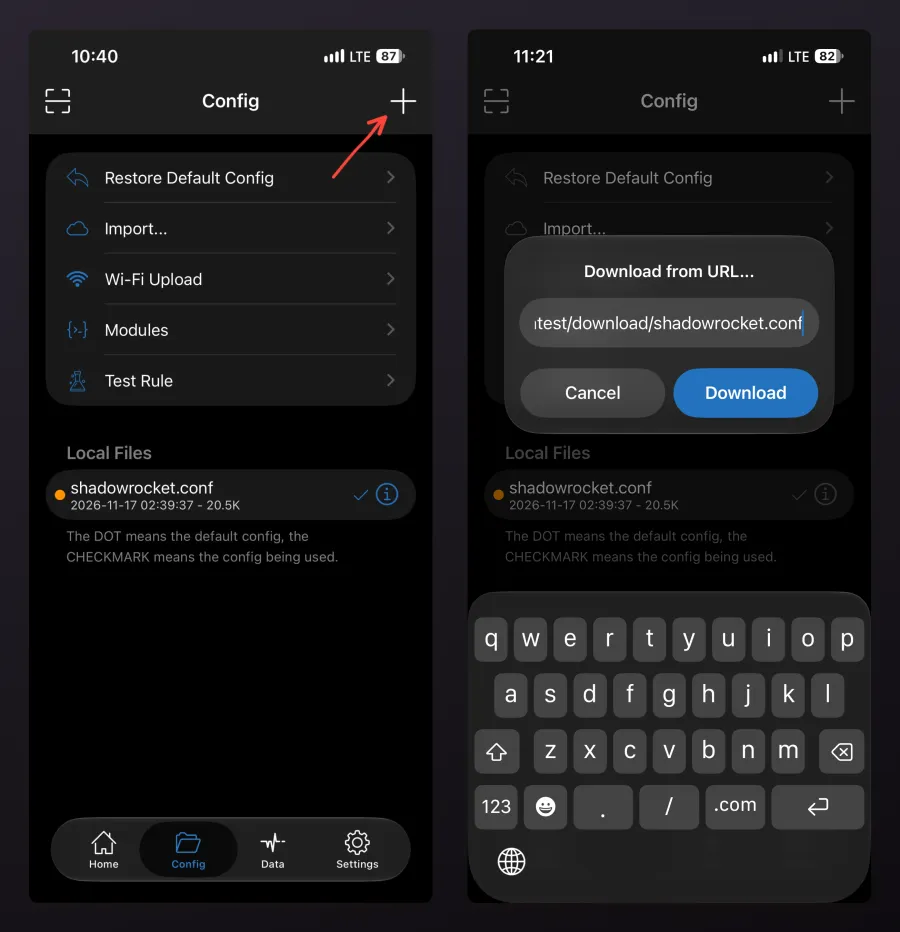
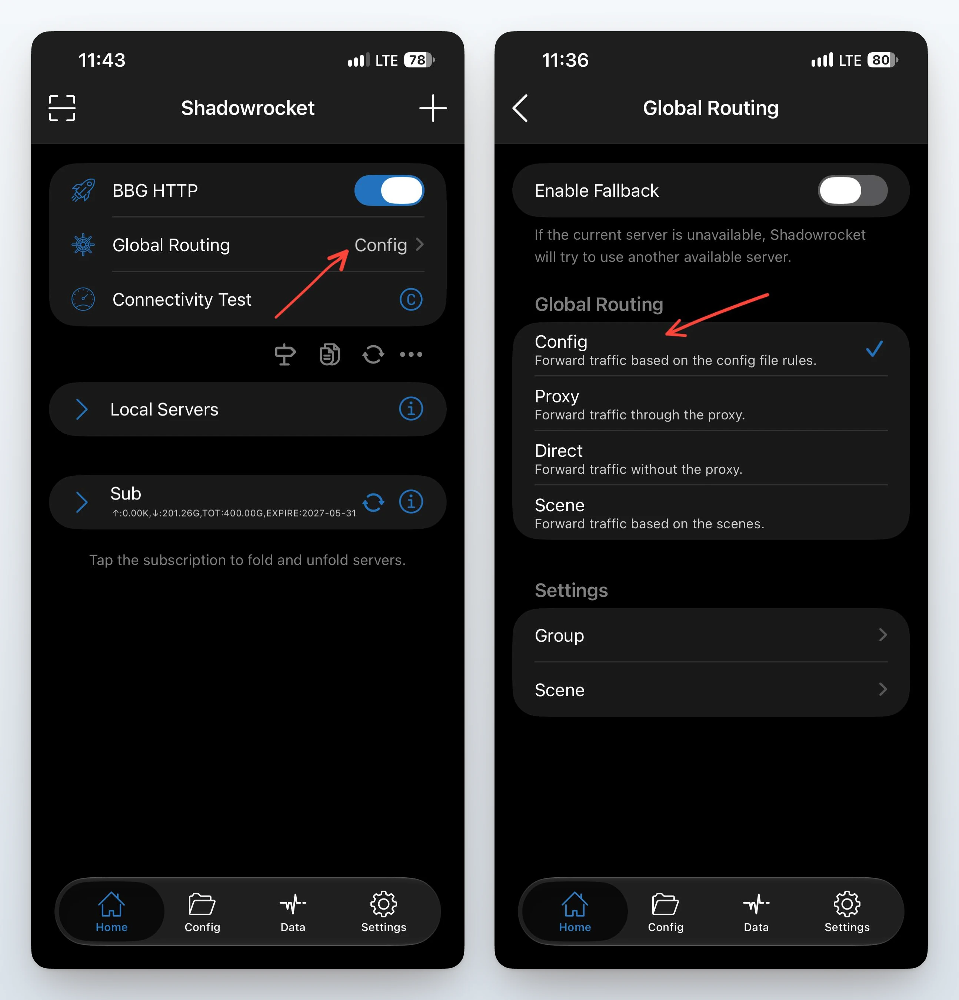

# Shadowrocket

## نصب با یک لمس

روی آیفون یا آیپدی که Shadowrocket روی آن نصب است، روی دکمه بزنید. Shadowrocket باز می‌شود، پیکربندی را
دانلود می‌کند و به آن تغییر می‌دهد.

[:material-rocket-launch: نصب در Shadowrocket](shadowrocket://config/add/https://github.com/aliraghebi/routing-rules/releases/latest/download/shadowrocket.conf){ .md-button .md-button--primary }

سپس در زبانه **Home** سرور خود را اضافه کنید و **Global Routing** را روی **Config** بگذارید.

!!! note "یادداشت"
    این دکمه فقط روی دستگاهی کار می‌کند که Shadowrocket روی آن نصب است. پیکربندی در حال استفاده را جایگزین
    می‌کند؛ برای نگه داشتن پیکربندی خودتان از [ماژول](#keep-your-own-config-module) استفاده کنید. اگر اتفاقی
    نیفتاد، مراحل دستی زیر را انجام دهید.

## وارد کردن دستی

1. نشانی پیکربندی را کپی کنید:

    ```
    https://github.com/aliraghebi/routing-rules/releases/latest/download/shadowrocket.conf
    ```

2. Shadowrocket ← زبانه **Config** ← **+** ← نشانی را بچسبانید ← **Download**.
3. روی پیکربندی جدید بزنید ← **Use Config**. تیک نشان‌دهنده پیکربندی در حال استفاده است.

    { width="720" loading=lazy }

4. در زبانه **Home** سرور خود را اضافه کنید و **Global Routing** را روی **Config** بگذارید.

    { width="480" loading=lazy }

### به‌روز نگه داشتن

فهرست‌ها هر روز تغییر می‌کنند. پیکربندی `update-url` دارد و همه فهرست‌ها `RULE-SET` راه دور هستند، پس
لازم نیست دوباره وارد کنید. برای به‌روزرسانی فوری، در زبانه **Config** روی پیکربندی بزنید ← **Update** (همان منوی
**Use Config** در تصویر بالا).

## پیکربندی خودتان را نگه دارید (ماژول) {#keep-your-own-config-module}

اگر پیکربندی دلخواه خودتان را دارید (سرورها، قوانین یا تنظیمات خودتان)، به‌جای وارد کردن پیکربندی بالا این
قوانین را به‌صورت **ماژول** اضافه کنید. ماژول همان قوانین را بدون قانون پایانی دارد، پس پیکربندی شما سرورها و
`FINAL` خودش را نگه می‌دارد.

[:material-puzzle-outline: نصب ماژول در Shadowrocket](shadowrocket://install?module=https://github.com/aliraghebi/routing-rules/releases/latest/download/routing-rules.sgmodule){ .md-button }

یا آن را دستی اضافه کنید:

1. نشانی ماژول را کپی کنید:

    ```
    https://github.com/aliraghebi/routing-rules/releases/latest/download/routing-rules.sgmodule
    ```

2. Shadowrocket ← زبانه **Config** ← **Modules** ← **+** ← نشانی را بچسبانید ← **Download**.
3. مطمئن شوید ماژول روشن است.

قوانین برای سایت‌هایی که IP ایران را مسدود می‌کنند از policy با نام `PROXY` (پراکسی داخلی Shadowrocket)
استفاده می‌کنند. ماژول‌ها مانند پیکربندی خودکار به‌روز می‌شوند؛ برای به‌روزرسانی فوری، ماژول را از صفحه
**Modules** به‌روز کنید.

## ترتیب قوانین

| # | قانون | عمل |
|---|-------|-----|
| ۱ | `ir-injected.list` (آدرس‌های صفحه مسدودسازی DNS ایران) | REJECT |
| ۲ | `private.list` (نام‌های محلی مانند `.lan`، `.local`، `localhost`، صفحه روترها؛ بازه‌های IP خصوصی) | DIRECT |
| ۳ | `malware.list`، `phishing.list`، `cryptominers.list`، `ads.list` | REJECT |
| ۴ | `sanctioned.list` | PROXY |
| ۵ | `DOMAIN-SUFFIX,ir`، `ir-domains.list` | DIRECT |
| ۶ | `ir-cidr.list` | DIRECT |
| ۷ | `GEOIP,IR` | DIRECT |
| ۸ | `FINAL` | PROXY |

## افزودن فهرست اختیاری

پیکربندی را ویرایش کنید (**Config** ← پیکربندی را لمس کنید و نگه دارید ← **Edit Config** ← **Rule**) و یک خط بالای
`FINAL` اضافه کنید. برای مثال:

```
RULE-SET,https://github.com/aliraghebi/routing-rules/releases/latest/download/nsfw.list,REJECT
RULE-SET,https://github.com/aliraghebi/routing-rules/releases/latest/download/telegram.list,PROXY
```

!!! warning "توجه"
    ویرایش محلی با به‌روزرسانی پیکربندی از `update-url` از بین می‌رود. برای حفظ تغییرات، پیکربندی خودتان را
    بسازید و فقط با خطوط `RULE-SET` به این فهرست‌ها ارجاع دهید.

نشانی همه فهرست‌ها: [نشانی فایل‌ها](urls.md#shadowrocket-rule-lists).

## فهرست‌های سبک‌تر

iOS حافظه برنامه‌های VPN را محدود می‌کند و `ads.list` بزرگ است. دو گزینه سبک‌تر:

- **DOMAIN-SET**: همان دامنه‌ها در قالبی که Shadowrocket و Surge بهینه‌تر بارگیری می‌کنند. خط `RULE-SET`
  یک فهرست دامنه را با خط `DOMAIN-SET` جایگزین کنید، مثلاً
  `DOMAIN-SET,https://github.com/aliraghebi/routing-rules/releases/latest/download/ads-domainset.txt,REJECT`. فایل‌های DOMAIN-SET فقط دامنه دارند، پس برای فهرست‌هایی که
  بازه IP هم دارند (`malware`، `phishing`) همان `RULE-SET` را نگه دارید.
- **ads-lite**: حدود ۵ هزار قانون از منابع کوچک و دست‌چین‌شده (شبکه‌های تبلیغاتی و ردیاب‌های ایرانی، فهرست
  Peter Lowe، v2fly) به‌جای حدود ۱۷۶ هزار. به‌جای `ads.list` از `ads-lite.list` (یا `ads-lite-domainset.txt`)
  استفاده کنید.

!!! note "یادداشت"
    پیکربندی پیش‌فرض `RULE-SET` با `ads.list` کامل را نگه می‌دارد. این گزینه‌ها روی همه دستگاه‌ها آزموده
    نشده‌اند؛ اگر برنامه مشکل حافظه دارد یا مدام دوباره وصل می‌شود، از آن‌ها استفاده کنید.
